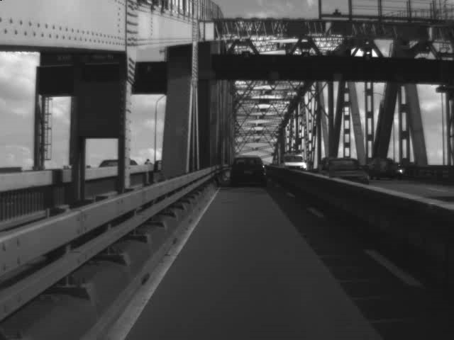
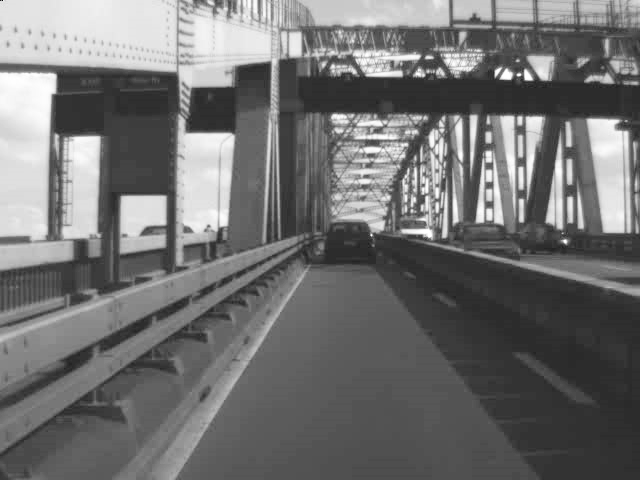
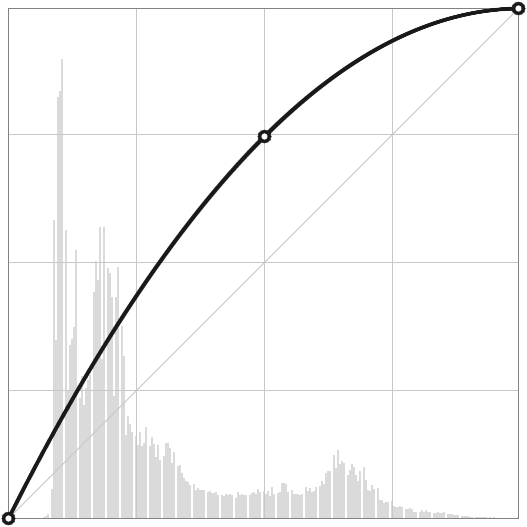
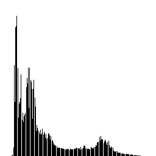
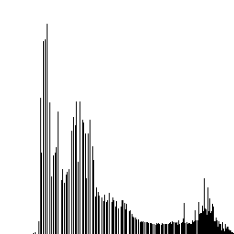

# Video editing curve tool in C++

A Curves tool, like the one in Adobe Photoshop, for video, written in C++ with OpenCV. In the curve window you add, drag and remove the control points of a tone curve. A frame of the video is shown with the curve applied, next to the original, with the histograms of both, and the curve can then be applied to every frame and written to a new video file. A headless mode applies a curve given on the command line.

Michael Perez wrote it for Assignment 1 of CAP 4410 Computer Vision, Florida Polytechnic University, fall 2019. Video reading and writing and the histograms use two classes from Robert Laganière's OpenCV 3 cookbook (see [Credits](#credits)). In 2026 saving was fixed (in 2019 it never saved the result of a curve), the curve code was replaced, and a CMake build, command-line options, a headless mode, tests and CI were added.

## Results

Output of `./build/curvetool --no-gui --curve 0:0,128:191,255:255 --images docs/images barriers.avi` on the 640×480 sample video. The curve brightens the shadows and midtones: input level 128 becomes 191, while black and white stay where they are.

| First frame | First frame with the curve |
| --- | --- |
|  |  |

The curve as the curve window draws it, over the histogram of the frame (grey):



| Histogram of the first frame | With the curve |
| --- | --- |
|  |  |

The program applies the curve to all 399 frames, writes them to `barriers_curves.avi` and reports:

```
Video: barriers.avi (640x480, 50 fps, 399 frames)
Curve: 0:0,128:191,255:255 (lookup table 0->0 64->111 128->191 192->239 255->255)
Wrote 399 of 399 frames to barriers_curves.avi (MJPG, 640x480, 50 fps) in 4.9 s
Levels over all frames: mean 79.2, standard deviation 58.0 before; mean 120.1, standard deviation 65.5 after
```

Curves of the kinds shown in the 2019 report (brightness, contrast and inversion), applied to the whole video. The levels are those of all 399 frames after the curve, as the program reports them; with conda-forge's OpenCV on macOS, decoding the written video gives the same mean within 0.1 levels.

| Curve | `--curve` | Mean level | Standard deviation |
| --- | --- | ---: | ---: |
| None (the input) | `0:0,255:255` | 79.2 | 58.0 |
| Brighter | `0:0,128:191,255:255` | 120.1 | 65.5 |
| Darker | `0:0,128:64,255:255` | 37.6 | 53.3 |
| More contrast | `0:0,64:40,192:215,255:255` | 68.0 | 70.4 |
| Less contrast | `0:0,64:90,192:165,255:255` | 90.8 | 45.5 |
| Inverted | `0:255,255:0` | 175.8 | 58.0 |

## How it works

1. **The curve** (`Curve.h`, `Curve.cpp`). Each control point maps an input level x to an output level y, both from 0 to 255, and the points are kept in order of x. The curve through them is a monotone piecewise cubic (Fritsch and Carlson, 1980), evaluated directly as a function y(x). The slope at each point starts as the slope of the parabola through the point and its neighbours. It is set to zero where the points form a peak or a valley, and reduced where needed so that each piece of the curve rises or falls steadily. The curve therefore passes through every point, has no corners, never overshoots between two points, and goes only up (or only down) wherever the points do. Before the first point and after the last one it is flat, so moving the end points inwards clips the shadows or the highlights.
2. **The lookup table.** The curve at levels 0 to 255, rounded to whole levels, is a table of 256 entries. `cv::LUT` applies it to every channel of a frame, so a colour video gets the same curve on all three channels, like Photoshop's RGB curve.
3. **The histograms** (`Histogram1D.h`). Laganière's `Histogram1D` class computes the 256-bin histogram of the gray-level frame with `cv::calcHist` and draws it. The curve window draws the histogram of the current frame behind the curve.
4. **Saving** (`VideoProcessor.h`). Laganière's `VideoProcessor` reads the video, calls the curve for every frame and writes the result with `cv::VideoWriter`. The output must be a different file from the input: by default it is `<name>_curves.avi` next to the input, and the program refuses an output that is the input, however the path is written. The writer is opened with the size and colour of the frames, every frame is checked against them before it is written, the number of frames written is reported, and the writer is closed so that the file is complete.

The video is written as Motion JPEG, which OpenCV can always write to an AVI file and which keeps the levels the curve produced closely. With conda-forge's OpenCV on macOS, every decoded frame of the sample differs from the expected frame by less than 1.3 levels on average, and its mean level by less than 0.1; with Ubuntu 26.04's OpenCV 4.10 and FFmpeg 8.0, as in CI, by less than 2 levels and 1.4. Re-encoding the sample with its own MPEG-4 codec through OpenCV's FFmpeg backend on macOS, with no curve, made the frames 2.8 levels darker on average and slightly green (blue lost 4.2 levels, red 3.2 and green 1.2), which a tool for adjusting levels should not do. The input's codec is used only if the output file cannot be written as Motion JPEG. Motion JPEG files are larger: 13 MB for the sample, which is 2.5 MB.

## Building

Requirements: CMake 3.16 or later, a C++17 compiler, and OpenCV 4 with the core, imgproc, imgcodecs, videoio and highgui modules. Reading `barriers.avi` (MPEG-4 Part 2 in an AVI file) needs OpenCV's FFmpeg video backend, which the packages below include. The windows need OpenCV built with a GUI backend (GTK, Qt, Cocoa or Win32); the headless mode and the tests open no windows.

Ubuntu or Debian:

```sh
sudo apt-get install build-essential cmake libopencv-dev
cmake -S . -B build -DCMAKE_BUILD_TYPE=Release
cmake --build build
```

macOS with Homebrew:

```sh
brew install cmake opencv
cmake -S . -B build -DCMAKE_BUILD_TYPE=Release
cmake --build build
```

conda-forge (Linux or macOS, with the system compiler):

```sh
conda create -n curves -c conda-forge cmake make libopencv
conda activate curves
cmake -S . -B build -DCMAKE_BUILD_TYPE=Release -DCMAKE_PREFIX_PATH="$CONDA_PREFIX"
cmake --build build
```

CI builds and tests the code against Ubuntu's OpenCV packages (OpenCV 4.10 and FFmpeg 8.0 on Ubuntu 26.04 in November 2026). It has also been built and tested with OpenCV 4.6 and 4.11 from conda-forge on macOS (Apple Clang 17).

## Running

```
./build/curvetool [options] [video]
```

| Option | Meaning |
| --- | --- |
| `video` | Input video (default: `barriers.avi` in the current directory) |
| `--curve POINTS` | Control points `x:y,x:y,...` that map input level x to output level y, from 0 to 255 (default `0:0,255:255`, which changes nothing). In the windows this is the starting curve. |
| `--out FILE` | The video to write (default: `<video>_curves.avi` next to the input). It may not be the input video. |
| `--images DIR` | Also write `curve.png`, `frame_before.png`, `frame_after.png`, `histogram_before.png` and `histogram_after.png` to `DIR`: the first frame in the headless mode, the frame shown when `p` is pressed in the windows |
| `--no-gui` | Do not open windows: apply the curve, write the video and exit |

Without `--no-gui` the program opens the five windows of the 2019 version: *Video Editing Curve Tool* (the curve), *Preview Interface* and *Preview Histogram* (the current frame with the curve), and *Video* and *Video Histogram* (the current frame as it is).

| Input | Action |
| --- | --- |
| Left click in the curve window | Add a point, or pick the point under the mouse, and drag it. A point cannot pass its neighbours. |
| Right click | Remove the point under the mouse (two points always remain) |
| Space | Play or pause the video; the preview and the histograms follow it |
| `p` | Apply the curve to the whole video and write it; any key stops |
| `r` | Reset the curve to a straight line |
| `q` or Esc | Quit |

```sh
./build/curvetool                                              # windows, on barriers.avi
./build/curvetool --no-gui --curve 0:0,64:40,192:215,255:255   # writes barriers_curves.avi
./build/curvetool --no-gui --curve 0:255,255:0 --out inverted.avi --images output clip.mp4
```

## Tests

```sh
(cd build && ctest --output-on-failure)
```

`tests/test_curve.cpp` tests the curve and its lookup table:

- the straight curve, and curves whose points all lie on the diagonal, give the identity table;
- the table gives every control point its exact output level, for 12 hand-placed curves (one with points at 0, 20, 30, 230 and 255, which the 2019 code missed by 149 levels at input 20) and 3,000 random curves with uneven spacing;
- control points that never decrease give a table that never decreases, and the same for points that never increase (hand-placed curves and 2,000 random ones), and no curve leaves the range of the two points around it (3,000 random curves);
- the curve is flat before the first point and after the last one, and its slope is continuous at the points;
- `--curve` parsing and its error messages, point editing (adding, moving without passing a neighbour, keeping two points) and the drawing of the curve window.

ctest also runs the headless mode on a copy of `barriers.avi` and checks the result with `tests/check_video.cpp`, which decodes the input and the written video, counts their frames (399 each), compares every written frame with the input frame after the curve (allowing 4 levels on average for the compression, and 2.5 for the mean level; Motion JPEG stays under 2 and 1.4 on both macOS and Ubuntu) and checks that `frame_before.png` and `frame_after.png` are exactly the first frame before and after the curve. Further tests check the default output name, that the input video is unchanged afterwards, and the messages for an output that is the input (written as `dir/./barriers.avi`), a missing video, a bad `--curve`, an unknown option and an images path that is a file, which is reported before the video is processed. The windows are not covered by the tests.

## Credits

- `VideoProcessor.h` and `Histogram1D.h` are from the code of R. Laganière, *OpenCV 3 Computer Vision Application Programming Cookbook*, third edition (Packt Publishing): `Chapter12/videoprocessor.h` and part of `Chapter04/histogram.h` in [PacktPublishing/OpenCV3-Computer-Vision-Application-Programming-Cookbook-Third-Edition](https://github.com/PacktPublishing/OpenCV3-Computer-Vision-Application-Programming-Cookbook-Third-Edition) (MIT License, Copyright (c) 2017 Packt). Both files keep their original copyright notice and include the repository's MIT License notice, and `VideoProcessor.h` lists the changes made to it.
- The 2019 version drew the curve with Radu Gruian's Overhauser (Catmull-Rom) spline code from ["Overhauser (Catmull-Rom) Splines for Camera Animation"](https://web.archive.org/web/20200520191522/https://www.codeproject.com/Articles/30838/Overhauser-Catmull-Rom-Splines-for-Camera-Animatio) (CodeProject, 2008, Code Project Open License), and its curve editor was adapted from Andrey Smorodov's [Stack Overflow answer](https://stackoverflow.com/a/23659732) (CC BY-SA 3.0). This version replaces both with its own curve code.
- F. N. Fritsch and R. E. Carlson, "Monotone Piecewise Cubic Interpolation", *SIAM Journal on Numerical Analysis* 17(2), 238–246, 1980, doi:[10.1137/0717021](https://doi.org/10.1137/0717021).
- `barriers.avi` is the demo video of the "Barriers" sequence in [Set 9](https://cerv.aut.ac.nz/set-9/) of EISATS, the .enpeda.. Image Sequence Analysis Test Site (University of Auckland), recorded with the .enpeda.. group's research vehicle HAKA1. EISATS permits using and publishing its images and asks users to cite the paper given for each set, which for this sequence is S. Hermann, S. Morales and R. Klette, "Half-resolution semi-global stereo matching", *2011 IEEE Intelligent Vehicles Symposium (IV)*, 201–206, 2011, doi:[10.1109/IVS.2011.5940427](https://doi.org/10.1109/IVS.2011.5940427).

## 2019 report

[Report.pdf](Report.pdf) is the write-up submitted for the assignment in September 2019. It describes the code as it was then. In this copy, Figure 7, a screenshot of the Stack Overflow answer that includes the "Lena" test image, was replaced by a note with a link to the answer. The report's reference [4] points to `Chapter12/histogram.h`, which does not exist; the file is `Chapter04/histogram.h`.
